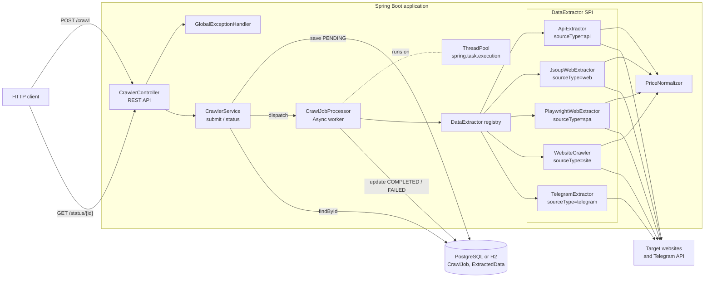
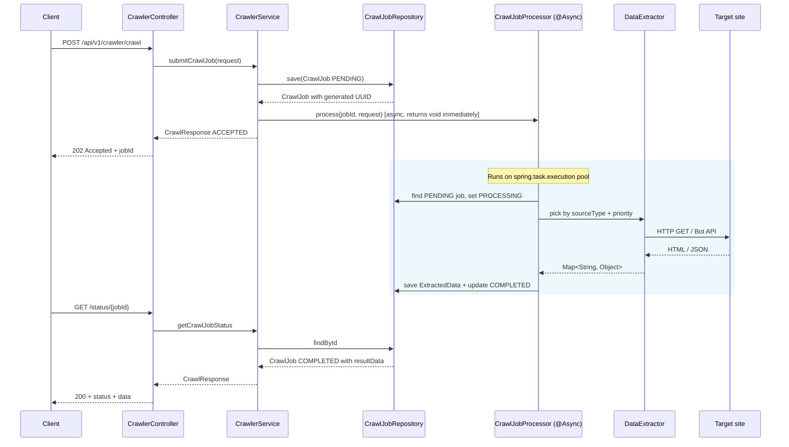
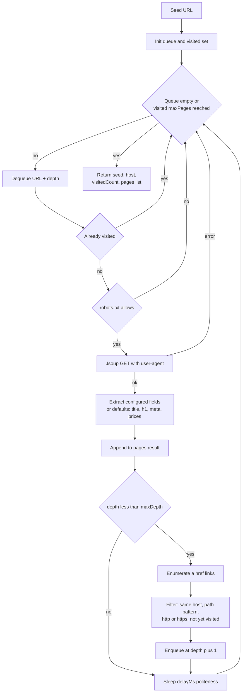
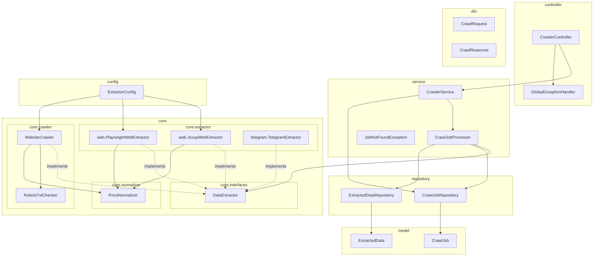
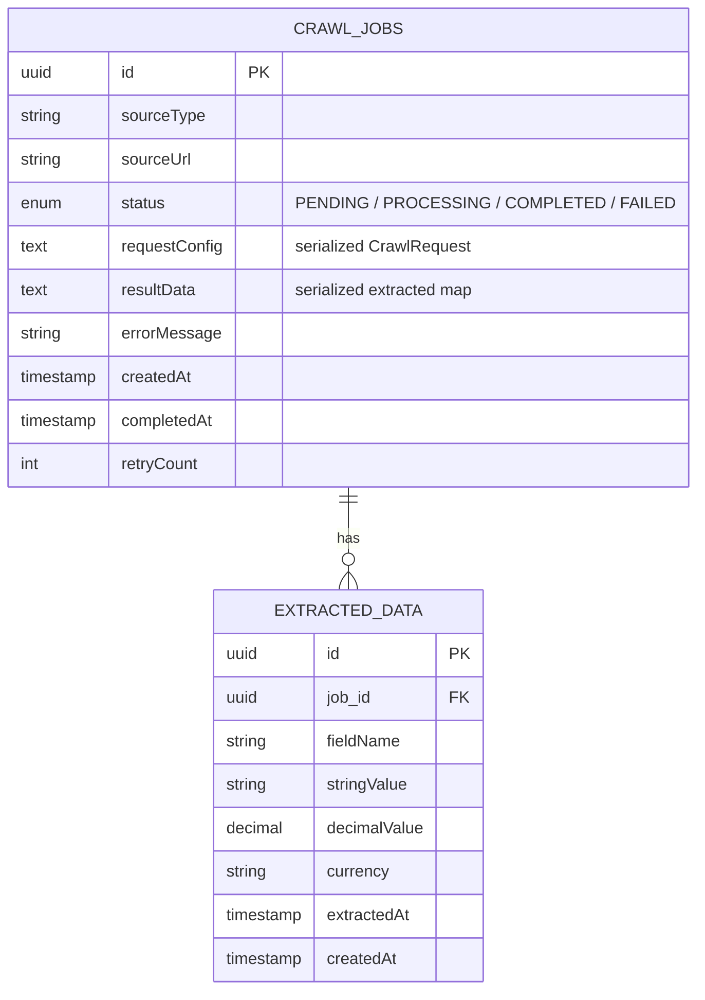

# Gen-Crawler — Architecture

## High-level flow

## Request lifecycle

## Site crawl (BFS with host fence)

## Package map

## Data model

## Extension points

- **`DataExtractor`** — add a new source by implementing `supports`, `extract`, `getPriority`, then registering the bean. The highest `getPriority()` among those that `supports(sourceType)` wins.
- **`PriceNormalizer.CURRENCY_LOCALES`** — add a new ISO currency by extending the map.
- **`RobotsTxtChecker`** — replace with a more complete parser (e.g., support `Allow`, `Crawl-delay`, sitemaps) if needed.

## Operational notes

- The async executor is auto-configured from `spring.task.execution.pool.*` in `application.yml` (5 core, 10 max, 100 queue).
- Transactions: `CrawlJobProcessor.process` is `@Transactional` + `@Async`; `CrawlerService.submitCrawlJob` stays non-transactional so the `save()` auto-commits before the async dispatch (avoids the classic "async sees an uncommitted row" race).
- UUID generation: `@GeneratedValue(strategy = GenerationType.UUID)` on both entities. The service reads the generated id from the saved entity — never sets it manually.
- Errors flow through `GlobalExceptionHandler`: `JobNotFoundException` → 404, `IllegalArgumentException` / validation → 400, anything else → 500 (logged).
